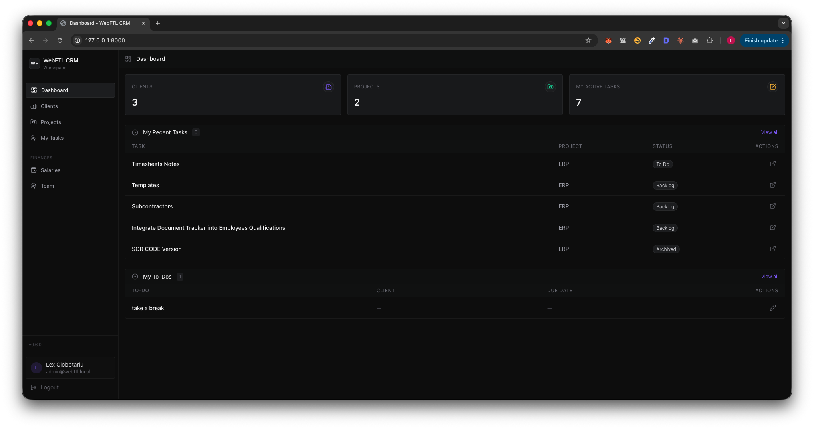
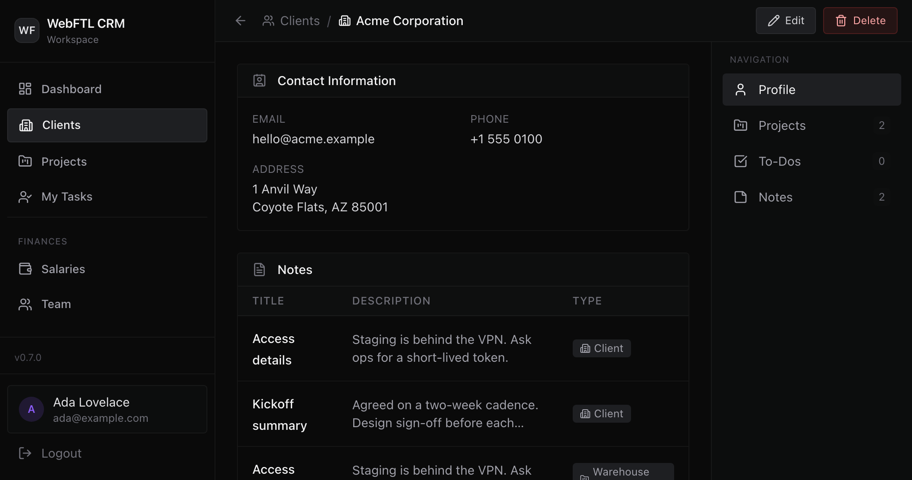
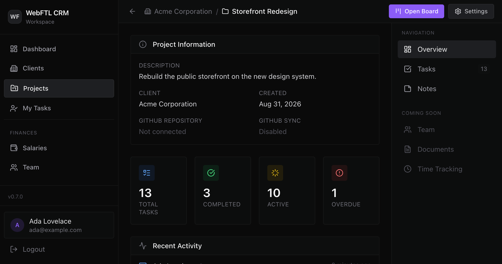
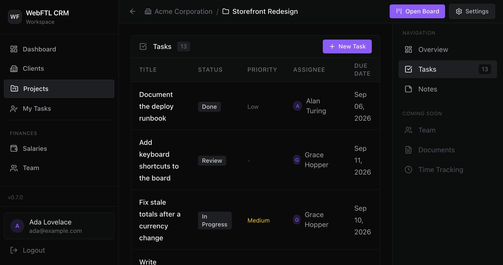
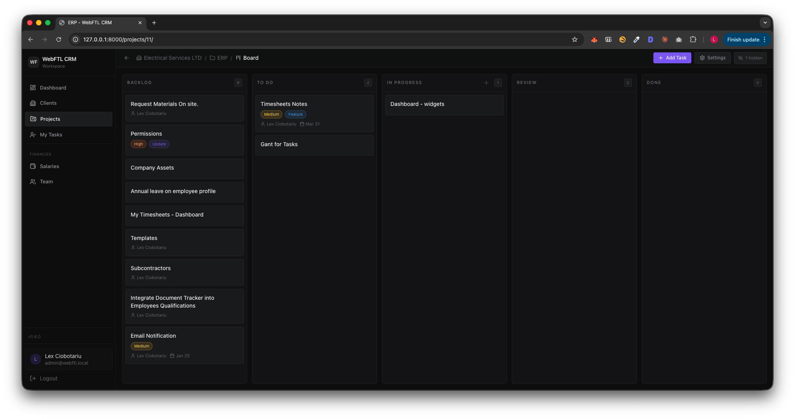
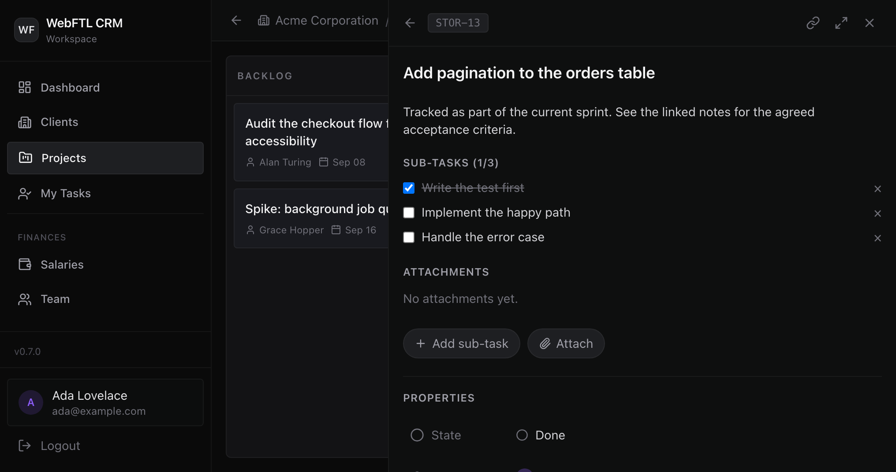
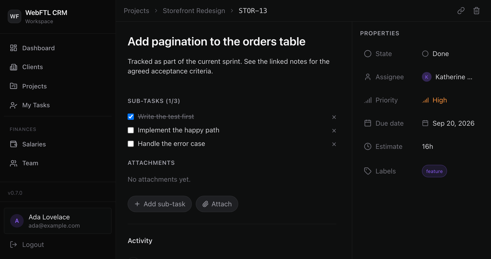

# WebFTL CRM

A personal CRM built for managing clients, projects, and tasks. I built this for my own freelancing needs — tracking who I'm working with, what's in progress, and what's next. It's lightweight, self-hosted, and gets out of your way.

You're free to use it, modify it, resell it, or do whatever you want with it. See [LICENSE](LICENSE) for details.



## Features

- **Clients** — contact info, notes, linked projects and todos
- **Projects** — overview with stats, activity log, GitHub repo sync (experimental)
- **Tasks** — one Tasks page per project with list and kanban board layouts, shared filters, grouping and sorting, drag-and-drop, a personal My Tasks list grouped by project, status, priority and assignee changed straight from a row or card, keyboard shortcuts, a Ctrl/Cmd+K search palette, a fast new-task drawer, subtasks, comments, attachments, labels, and activity tracking
- **Time tracking** — a running timer or manual entries on tasks, and estimates and durations written as `1h 30m`, with a weekly view of your logged time
- **Invoices** — per-client invoices with project and free-text lines, payments, and a currency per client
- **Todos** — personal to-do list with optional client association and due dates
- **Notes** — quick notes attached to clients
- **Salaries** — employee salary tracking with monthly breakdowns and payment records
- **Team** — user management with role-based access control (RBAC), permission presets, and user deactivation
- **Dashboard** — at-a-glance stats, recent tasks, and pending todos

## Screenshots

<details>
<summary>Client Detail</summary>


</details>

<details>
<summary>Project Overview</summary>


</details>

<details>
<summary>Task List</summary>


</details>

<details>
<summary>Kanban Board</summary>


</details>

<details>
<summary>Task Detail (Sidebar)</summary>


</details>

<details>
<summary>Task Detail (Full Page)</summary>


</details>

## Tech Stack

- **Backend:** Django 5.2 (LTS), Python 3.12+
- **Frontend:** HTMX, Alpine.js, Tailwind CSS
- **Database:** PostgreSQL 16
- **Server:** gunicorn with uvicorn workers (ASGI), for live updates
- **Auth:** django-allauth (email-based, no username)
- **Icons:** Lucide

## Getting Started

### Prerequisites

- Python 3.12+
- Docker (for the database)

### 1. Clone the repo

```bash
git clone https://github.com/lexciobotariu/webftl_crm.git
cd webftl_crm
```

### 2. Start the database

```bash
docker compose up -d
```

This starts a PostgreSQL 16 container on port 5433.

### 3. Set up the environment

```bash
cp .env.example .env
```

Edit `.env` if needed. The defaults work out of the box for local development.

Set `TIME_ZONE` (an IANA name such as `Europe/Bucharest`, the default) to the zone
your team works in. It is the one time zone for the whole app: it decides what
"today" is, which day a logged time falls on, and the hours shown everywhere.
Stored dates and times are UTC, so changing it later moves nothing in the database.

### 4. Create a virtual environment and install dependencies

```bash
python3 -m venv .venv
source .venv/bin/activate
pip install -r requirements.txt
```

### 5. Run migrations and create a superuser

```bash
python manage.py migrate
python manage.py createsuperuser
```

### 6. Start the dev server

```bash
python manage.py runserver
```

Open [http://localhost:8000](http://localhost:8000) and log in.

`runserver` has no live updates on the task pages (see below). To see them,
run the server the way production does:

```bash
gunicorn config.asgi:application -k uvicorn_worker.UvicornWorker --reload -b 127.0.0.1:8000
```

## Running Tests

The test tooling lives in `requirements-dev.txt`, which is not installed by the
steps above:

```bash
pip install -r requirements-dev.txt
pytest
```

## Scheduled jobs

Recurring invoices become drafts only when this command runs, so schedule it
once a day (in Dokploy: the app's Schedules tab, or any cron that can run a
command in the web container):

```bash
python manage.py create_recurring_invoices
```

Running it more than once a day is harmless, and a missed day is caught up on
the next run.

## File storage

Uploaded files (task attachments) go to the server disk until an admin connects
an S3-compatible bucket under **Settings > File storage** (Amazon S3, Cloudflare
R2, Backblaze B2, Hetzner, DigitalOcean Spaces, MinIO). The container has no
volume for `media/`, so in production files on the disk are lost on every
deploy; connect a bucket before relying on attachments.

The bucket stays private. Downloads go through the app, which checks access
and then redirects to a signed link valid for five minutes. The keys need
permission to put, get, head and delete objects in the bucket. Files saved on
the disk before the bucket was connected are still served from the disk.

## Two-factor sign-in

Anyone can turn on an authenticator app under **Security** in the sidebar
(allauth MFA: TOTP plus 10 recovery codes). Admins must: until they have it,
every page sends them to the setup page.

Someone who lost both the phone and the recovery codes:

```bash
python manage.py reset_two_factor person@example.com
```

They then sign in with the password and set it up again. If no admin can get
in to run that, set `REQUIRE_ADMIN_2FA=False` in the environment, redeploy,
sign in, set it up again, and remove the variable.

## Claude (MCP)

People can work on tasks from Claude (claude.ai, the Claude apps, Claude Code)
through the MCP endpoint at `https://<your domain>/mcp`: search and read
tasks, create and update them, labels, statuses, comments, subtasks, the
timer and logged time, plus "start work" / "finish work". No deletes and
nothing about invoices or salaries.

- **Who:** admins, and people whose permission preset has
  **Tasks → Use from Claude** ticked (off by default).
- **Connecting:** in Claude add a custom connector with the address above
  (Claude Code: `claude mcp add --transport http webftl https://<your domain>/mcp`).
  A browser window opens on the CRM: sign in (with two-factor), choose what
  Claude may do, press Allow.
- **How it is secured:** OAuth 2.1 with this app as the authorization server
  (django-oauth-toolkit): authorization code with PKCE, access tokens valid
  one hour and refresh tokens rotated on use, both stored hashed, bound to
  the `/mcp` address. Clients register themselves, but only with Claude's
  callback addresses or a loopback address (Claude Code); others can be added
  with `MCP_EXTRA_REDIRECT_URIS`. Each call runs with that person's own
  permissions; changes show as "via Claude" in task activity.
- **Disconnecting:** Security → Connected apps → Disconnect. Deactivating a
  person stops their connections at once.

## Live updates on the task pages

The task list and board (project and My Tasks), the task page and the task
drawer update by themselves when someone else changes a task: a colleague,
Claude through MCP, the GitHub webhook. Nothing polls. Each open task page
keeps one server-sent events connection (`/live/tasks/`), and every change to
a task, its subtasks, comments, time or files sends one message naming the
task. The page then reloads what it shows through the normal views; while
someone is typing, has a menu open or is dragging a card, it waits until they
are done. The tab that made a change does not reload for it.

- **Server:** gunicorn with uvicorn workers (ASGI, `config/asgi.py`), set in
  the Dockerfile. Under WSGI (`runserver`) the endpoint answers 204 and pages
  simply do not update live.
- **Carrier between server processes:** Postgres `LISTEN/NOTIFY` by default,
  no extra service. Set `REDIS_URL` to use Redis pub/sub instead.

## Frontend dependencies

There is no build step. Our own scripts live in `static/js/`; with
`DEBUG` off, run `collectstatic` after changing them. HTMX (plus its `alpine-compat` extension), Alpine.js (plus the `sort` and `collapse` plugins),
Lucide and Iconify are loaded from a CDN, each pinned to an exact version and
verified with Subresource Integrity — bumping one means recomputing its
`integrity` hash in `templates/base.html`.

Tailwind is the exception: it is loaded from `cdn.tailwindcss.com`, which is a
versionless in-browser JIT compiler. That means no pinning, no SRI, a runtime
dependency on the CDN, and a slower first paint than a compiled stylesheet. It is
a deliberate tradeoff to keep the project buildless; replacing it with a compiled
Tailwind build is the first thing to do if you deploy this somewhere that matters.

## Documentation

- [`CHANGELOG.md`](CHANGELOG.md) — what changed in each version (the in-app changelog page reads it)
- [`docs/roadmap.md`](docs/roadmap.md) — the tasks roadmap: what was planned, what shipped, and the decisions that still bind future work
- [`docs/ui-patterns.md`](docs/ui-patterns.md) — how the UI is built and the conventions a new screen should follow

## GitHub integration

The GitHub sync (repo issues ↔ tasks, plus the webhook) is **experimental**. It
covers issue create/close in one direction and has seen limited real-world use.
Treat it as a starting point rather than a finished feature.

## License

MIT — do whatever you want with it.
